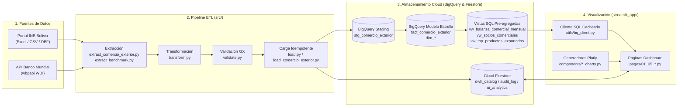
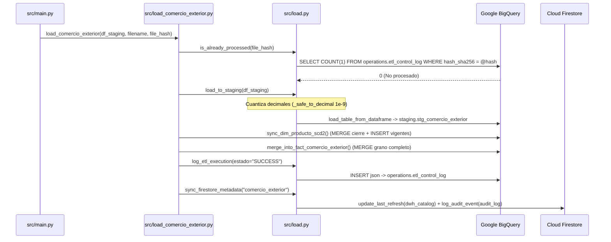

# Arquitectura y Funcionamiento Interno de InsightBolivia

Este documento describe de manera detallada el funcionamiento interno de la plataforma **InsightBolivia**, abarcando el ciclo de vida completo del dato: **orquestación, extracción, transformación, validación de calidad, carga idempotente en Google BigQuery y Cloud Firestore, capa de consultas SQL y renderizado de gráficos interactivos en Streamlit**.

---

## 1. Visión General de la Arquitectura

La plataforma está dividida en dos subsistemas desacoplados que se comunican a través de **Google BigQuery** (motor analítico OLAP) y **Google Cloud Firestore** (motor operacional OLTP):

1. **Backend / Pipeline ETL (`src/` y `sql/`)**: Extrae bases de datos de Comercio Exterior del INE Bolivia y series macroeconómicas del Banco Mundial (WDI), normaliza los esquemas, valida la integridad con *Great Expectations (GX 1.x)* y persiste los datos de forma atómica e idempotente.
2. **Frontend / Aplicativo Analítico (`streamlit_app/`)**: Consume exclusivamente vistas pre-agregadas en BigQuery mediante funciones parametrizadas y cacheadas (`@st.cache_data(ttl=3600)`), renderizando tableros interactivos con **Plotly** a costo **$0.00 USD** dentro del *Always Free Tier*.

---

## 2. Orquestación Principal (`src/main.py` y `src/init_dwh.py`)

### 2.1 Orquestador del Pipeline ETL (`src/main.py`)
El punto de entrada para la ejecución diaria/mensual del pipeline es `src/main.py`:

- **`run_etl_pipeline(options, bq_client, fs_client)`**: Inicializa el logging estructurado, valida variables de entorno, descubre los archivos a procesar (`_discover_files_to_process()`) e itera sobre cada archivo invocando `process_single_file()`.
- **`process_single_file(file_path, operation_type, options, ...)`**: Ejecuta secuencialmente las 4 fases para cada archivo:
  1. **Cálculo de Hash e Idempotencia Previa**: Calcula el hash criptográfico `SHA-256` (`compute_sha256()`) y consulta `is_already_processed()` en BigQuery para omitir archivos ya procesados (`status = "SKIPPED"`).
  2. **Lectura y Transformación a Staging**: Invoca `read_raw_file()` y `transform_to_staging()`, aplicando filtrado por fechas (`filter_dataframe_by_date()`) si se especificó `--date-range`.
  3. **Transformación a Hechos y Validación GX**: Genera el esquema de tabla de hechos (`transform_to_fact()`) y ejecuta `validate_transformed_data()`. Si la validación falla, detiene la ingesta de ese archivo (`status = "VALIDATION_FAILED"`).
  4. **Carga en BigQuery y Firestore**: Si no está activo `--dry-run`, llama a `load_comercio_exterior()`.

### 2.2 Aprovisionamiento del Data Warehouse (`src/init_dwh.py`)
El módulo `src/init_dwh.py` (`provision_dwh()`) automatiza la creación inicial e idempotente de la infraestructura en BigQuery:
1. **Creación de 4 Datasets (`create_datasets()`)**: `staging`, `comercio_exterior`, `benchmark_regional` y `operations`.
2. **Creación de 12 Tablas DDL (`sql/ddl/*.sql`)**: Tablas de staging, dimensiones (`dim_tiempo`, `dim_producto`, `dim_pais`, `dim_departamento_origen_destino`, `dim_via_transporte`, `dim_aduana`, `dim_moneda`), tablas de hechos (`fact_comercio_exterior`, `fact_indicadores_bm`) y auditoría (`etl_control_log`, `ui_analytics_aggregated`).
3. **Creación de 3 Vistas Analíticas (`sql/views/*.sql`)**: Vistas pre-agregadas para consumo desde Streamlit.
4. **Siembra de Dimensiones Estáticas (`seed_dim_*()`)**: Poblamiento inicial mediante `MERGE` de `dim_tiempo` (2000–2030), los 9 departamentos de Bolivia, vías de transporte, monedas y catálogo de países ISO-3.

---

## 3. Extracción de Datos (`Extract`)

### 3.1 Comercio Exterior — INE Bolivia (`src/extract_comercio_exterior.py` y `src/extract.py`)
- **Sesión HTTP Resiliente (`create_resilient_session()`)**: Configura una sesión `requests.Session` con cabecera `User-Agent` de navegador real y adaptador `HTTPAdapter` con estrategia de reintentos exponenciales (`urllib3.util.retry.Retry` sobre códigos HTTP `429, 500, 502, 503, 504`).
- **Web Scraping Dinámico (`scrape_ine_resources()`)**: Analiza con `BeautifulSoup` los portales del INE (`INE_EXPORTACIONES_URL` e `INE_IMPORTACIONES_URL`), identificando enlaces a archivos `.xlsx`, `.xls`, `.csv`, `.dbf`, `.zip` o vínculos a `nube.ine.gob.bo`, excluyendo automáticamente los diccionarios de datos.
- **Descarga en Streaming con Control SHA-256 (`download_resource()`)**:
  - Descarga el recurso en bloques de 64 KB hacia un archivo temporal mientras actualiza el hash `SHA-256` en memoria.
  - Si el hash ya figura en `known_hashes`, elimina el archivo temporal y retorna estado `SKIPPED_EXISTING`.
  - Sanitiza el nombre del archivo (`_extract_filename_from_response()`) y valida con `.resolve()` que la ruta destino permanezca dentro del directorio autorizado (prevención contra *Path Traversal* CWE-22).
- **Lectura de Archivos Locales (`src/extract.py`)**:
  - `read_ine_excel()`: Lee hojas Excel en modo texto (`dtype=str`) para conservar ceros a la izquierda en códigos arancelarios.
  - `_read_csv_with_encoding()`: Intenta decodificar en `UTF-8` y, ante `UnicodeDecodeError`, detecta la codificación exacta mediante `charset_normalizer`.

### 3.2 Benchmark Internacional — Banco Mundial (`src/extract_benchmark.py`)
- **`fetch_world_bank_data()`**: Utiliza la librería `wbgapi` (`wb.data.fetch()`) para consultar la API de *World Development Indicators (WDI)* del Banco Mundial para Bolivia y países de referencia sudamericanos (`BOL`, `PER`, `CHL`, `COL`, `PRY`, `BRA`, `ARG`, `ECU`, `URY`).
- Extrae 8 series macroeconómicas (`DEFAULT_INDICATORS`), incluyendo PIB actual (`NY.GDP.MKTP.CD`), crecimiento del PIB (`NY.GDP.MKTP.KD.ZG`), crecimiento de exportaciones/importaciones (`NE.EXP.GNFS.KD.ZG`, `NE.IMP.GNFS.KD.ZG`), inflación (`FP.CPI.TOTL.ZG`) y apertura comercial (`NE.TRD.GNFS.ZS`).

---

## 4. Transformación y Calidad de Datos (`Transform & Validate`)

### 4.1 Transformación y Normalización (`src/transform.py` y `src/country_iso_mapping.py`)
El módulo `src/transform.py` convierte los datos crudos heterogéneos del INE en estructuras limpias y tipadas:

| Función en `src/transform.py` | Responsabilidad Técnica |
| :--- | :--- |
| `read_raw_file()` | Lectura unificada de archivos `.xlsx`, `.xls`, `.csv` (con `charset_normalizer`) y `.dbf` (con `dbfread`). |
| `normalize_column_names()` | Resuelve alias históricos del INE (`EXPORT_COLUMN_ALIASES`, ej. `VIASAL2 -> VIASAL`, `GCE -> GCE3`). |
| `format_nandina()` | Elimina sufijos decimales `.0`, recorta espacios y aplica `.str.zfill(10)` para asegurar códigos NANDINA de 10 dígitos exactos. |
| `parse_flujo()` | Separa el campo `FLUJO` de exportaciones en `flujo_codigo` (numérico) y `flujo_descripcion`. |
| `derive_temporal_columns()` | Calcula `anio`, `mes`, `trimestre` (`(mes - 1) // 3 + 1`) y construye la fecha representativa `YYYY-MM-01` (`datetime.date`). |
| `convert_fob_bob()` | Calcula `valor_fob_bob` multiplicando `valor_fob_usd` por el tipo de cambio oficial (`6.96 BOB/USD`). |
| `transform_to_staging()` | Renombra columnas del INE según `EXPORT_INE_TO_STAGING_MAP` / `IMPORT_INE_TO_STAGING_MAP`, extrae `capitulo_nandina` (2 primeros dígitos), añade metadatos de auditoría (`tipo_operacion`, `nombre_archivo_origen`, `hash_sha256`, `fecha_ingesta`) y deduplica filas (`deduplicate_records()`). |
| `transform_to_fact()` | Construye el DataFrame para `fact_comercio_exterior`, mapeando códigos y nombres de países del INE a **ISO 3166-1 alpha-3** mediante `map_country_to_iso3()` (`src/country_iso_mapping.py`). |

### 4.2 Validación de Calidad con Great Expectations (`src/validate.py`)
Antes de permitir cualquier escritura en BigQuery, `validate_transformed_data()` ejecuta la suite `comercio_exterior_suite` construida en `build_comercio_exterior_suite()`:
1. **Completitud estricta (0% nulos)**: `ExpectColumnValuesToNotBeNull` sobre `fecha`, `codigo_nandina`, `pais_iso` y `tipo_operacion`.
2. **Completitud con umbral ($\le 5\%$ nulos, `mostly=0.95`)**: Sobre `valor_fob_usd`, `id_departamento`, `id_via_transporte`, `id_aduana`, `anio`, `mes` y `trimestre`.
3. **Integridad de rangos**: `valor_fob_usd >= 0`, `valor_fob_bob >= 0`, `mes` entre `1` y `12`, `trimestre` entre `1` y `4`.
4. **Coherencia física (`mostly=0.99`)**: `ExpectColumnPairValuesAToBeGreaterThanB` verifica que `peso_bruto_kg >= peso_neto_kg` (ignorando filas donde falte alguno de los dos pesos en importaciones).
5. **Formato arancelario y dominio**: `codigo_nandina` debe cumplir la expresión regular `^\d{10}$` y `tipo_operacion` debe pertenecer a `["EXPORTACION", "IMPORTACION"]`.

---

## 5. Cargado de Datos (`Load`) en BigQuery y Firestore

El proceso de carga reside en `src/load.py` (utilidades base) y `src/load_comercio_exterior.py` (lógica DML del modelo en estrella):

### Paso a Paso del Cargado:
1. **Verificación de Idempotencia (`src/load.py -> is_already_processed()`)**:
   Ejecuta una consulta parametrizada en `operations.etl_control_log` verificando si ya existe un registro con el mismo `hash_sha256` y `estado = 'SUCCESS'`.
2. **Aterrizaje en Staging (`src/load.py -> load_to_staging()`)**:
   Normaliza fechas y convierte todas las columnas numéricas (`NUMERIC` en BigQuery) a objetos `decimal.Decimal` cuantizados a 9 decimales (`_safe_to_decimal()`) para compatibilidad con PyArrow, cargando el lote en `staging.stg_comercio_exterior`.
3. **Actualización SCD Tipo 2 de Productos (`src/load_comercio_exterior.py -> sync_dim_producto_scd2()`)**:
   Mantiene el historial de cambios en `comercio_exterior.dim_producto`:
   - **Cierre (`MERGE`)**: Si un `codigo_nandina` vigente cambió su `descripcion_producto` o `sector_economico`, marca el registro anterior con `es_vigente = FALSE` y `vigente_hasta = CURRENT_DATE()`.
   - **Inserción (`INSERT INTO`)**: Inserta los nuevos códigos NANDINA o las nuevas versiones vigentes con `es_vigente = TRUE` y `vigente_desde = CURRENT_DATE()`.
4. **Upsert Atómico en Tabla de Hechos (`src/load_comercio_exterior.py -> merge_into_fact_comercio_exterior()`)**:
   Ejecuta una sentencia `MERGE` en `comercio_exterior.fact_comercio_exterior` leyendo de `staging.stg_comercio_exterior` (agrupado por grano completo y unido con `dim_pais`):
   - **Surrogate Key**: Calcula `id_transaccion` con `FARM_FINGERPRINT(...)`.
   - **Clave Natural de Cruce (`ON`)**: `(fecha, codigo_nandina, pais_iso, tipo_operacion, id_departamento, id_via_transporte, id_aduana)`.
   - Si el registro ya existe (`WHEN MATCHED`), actualiza las métricas monetarias y de peso; si no existe (`WHEN NOT MATCHED`), lo inserta.
5. **Auditoría y Sincronización con Firestore (`src/load.py` y `src/firestore_client.py`)**:
   - `log_etl_execution()`: Inserta el resultado de la corrida en `operations.etl_control_log`.
   - `sync_firestore_metadata()`: Actualiza `last_data_refresh` y `record_count` en la colección `dwh_catalog` de Cloud Firestore y registra un evento inmutable en `audit_log`.
6. **Carga de Benchmark Regional (`src/extract_benchmark.py -> load_benchmark_to_bigquery()`)**:
   Trunca la tabla temporal `staging.stg_indicadores_bm` y ejecuta un `MERGE` hacia `benchmark_regional.fact_indicadores_bm` cruzando por `(pais_iso, codigo_indicador, anio)`.

---

## 6. Queries para la Visualización (`sql/views/` y `streamlit_app/utils/bq_client.py`)

Para cumplir con la **Regla de Oro de Costo $0 USD**, Streamlit no realiza escaneos directos sobre la tabla cruda para construir gráficos, sino que consulta vistas pre-agregadas mediante un cliente cacheado.

### 6.1 Capa 1: Vistas Analíticas en BigQuery (`sql/views/`)
1. **`sql/views/vw_balanza_comercial_mensual.sql`**:
   Cruza `fact_comercio_exterior` con `dim_tiempo` y pre-agrega mensualmente `total_exportaciones_usd` (FOB), `total_importaciones_usd` (CIF), `saldo_balanza_usd` (`FOB - CIF`), pesos netos/brutos y número de transacciones.
2. **`sql/views/vw_socios_comerciales.sql`**:
   Cruza `fact_comercio_exterior` con `dim_tiempo` y `dim_pais`, agrupando por año, `tipo_operacion`, `pais_iso`, `nombre_pais_es`, `continente`, `subregion` y `bloque_comercial`.
3. **`sql/views/vw_top_productos_exportados.sql`**:
   Cruza `fact_comercio_exterior` con `dim_producto` (`es_vigente = TRUE`) para exportaciones y filtra los 10 productos principales de cada año mediante la cláusula ventana `QUALIFY ROW_NUMBER() OVER (PARTITION BY t.anio ORDER BY SUM(f.valor_fob_usd) DESC) <= 10`.

### 6.2 Capa 2: Funciones de Consulta en Python (`streamlit_app/utils/bq_client.py`)
Todas las funciones de consulta están decoradas con **`@st.cache_data(ttl=3600)`** (1 hora de caché en memoria), emplean `bigquery.ScalarQueryParameter` / `ArrayQueryParameter` (mitigación de SQL Injection) y normalizan tipos `decimal.Decimal` a `float64` (`_normalize_numeric_columns()`):

| Función en `streamlit_app/utils/bq_client.py` | Tabla / Vista Consultada en BigQuery | Filtros Soportados |
| :--- | :--- | :--- |
| `run_query(query, _params)` | Ejecutor genérico cacheado | Parámetros seguros `QueryJobConfig` |
| `get_balanza_comercial()` | `comercio_exterior.vw_balanza_comercial_mensual` | `start_date`, `end_date` (`fecha`) |
| `get_socios_comerciales()` | `comercio_exterior.vw_socios_comerciales` | `flow` (`EXPORTACION`/`IMPORTACION`), `year`, `limit` |
| `get_top_productos()` | `comercio_exterior.vw_top_productos_exportados` | `year` (`anio`), `limit` (`ranking <= @limit`) |
| `get_available_date_range()` | `comercio_exterior.vw_balanza_comercial_mensual` | Obtiene `MIN(fecha)` y `MAX(fecha)` disponibles |
| `get_export_microdatos()` | `fact_comercio_exterior` + `LEFT JOIN` a `dim_producto`, `dim_pais`, `dim_departamento_origen_destino` | `start_date`, `end_date`, `flow`, `departamentos`, `sectores`, `search_term`, `limit=50001` |
| `get_benchmark_indicadores()` | `benchmark_regional.fact_indicadores_bm` | `indicator_code`, `countries`, `start_year`, `end_year` |

*(Adicionalmente, `streamlit_app/utils/firestore_client.py` provee `get_cached_dwh_catalog()` para leer el estado del catálogo desde Firestore y `log_ui_event()` para registrar telemetría de navegación en la colección `ui_analytics`).*

---

## 7. Creación de Gráficos y Componentes Visuales (`streamlit_app/`)

El frontend separa la lógica de construcción de gráficos (**`streamlit_app/components/`**) de la estructura de páginas (**`streamlit_app/pages/`**). Todos los gráficos se generan como objetos interactivos `plotly.graph_objects.Figure` (`go.Figure`) con tema oscuro institucional (`Slate/Emerald`) y se renderizan en las páginas mediante `st.plotly_chart()`.

### Mapa Detallado de Páginas, Componentes y Gráficos

| Página en `streamlit_app/pages/` | Módulo de Componentes en `streamlit_app/components/` | Funciones Creadoras de Gráficos (`Plotly`) y Cálculos |
| :--- | :--- | :--- |
| **Landing Page Principal** `streamlit_app/app.py` | `utils/firestore_client.py` | • Renderiza tarjetas de estado operativo en vivo desde Firestore (`dwh_catalog`): estado activo, fecha de última sincronización, total de registros consolidados y tarjetas de acceso a los 5 módulos. |
| **01. Balanza Comercial** `01_balanza_comercial.py` | `balanza_charts.py` | • **`compute_balanza_kpis()`**: Calcula totales FOB, CIF, saldo comercial, condición de superávit/déficit y tasa de cobertura (`FOB / CIF * 100`). • **`aggregate_balanza_data()`**: Re-agrega el DataFrame dinámicamente según la granularidad seleccionada (*Mensual*, *Trimestral* o *Anual*). • **`build_evolution_chart()`**: Gráfico `go.Scatter` de líneas suavizadas (`spline`) con relleno al eje cero comparando Exportaciones FOB vs Importaciones CIF. • **`build_balance_bar_chart()`**: Gráfico `go.Bar` del saldo comercial coloreado dinámicamente en verde (`#10B981`, superávit) o rojo (`#EF4444`, déficit) con línea de equilibrio en `$0`. • **`build_annual_comparison_chart()`**: Gráfico de barras agrupadas (`barmode="group"`) por gestión anual. • **`build_volume_chart()`**: Evolución de volumen físico en miles de toneladas métricas (`kTon`). |
| **02. Socios Comerciales** `02_socios_comerciales.py` | `socios_charts.py` | • **`compute_socios_kpis()`**: Calcula volumen total, países activos, socio #1 y bloque económico líder. • **`build_choropleth_map()`**: Mapa mundial coroplético (`go.Choropleth`) por código `ISO-3` con escalas de color diferenciadas para Exportaciones (esmeralda) e Importaciones (azul) y zoom regional. • **`build_top_partners_bar_chart()`**: Gráfico de barras horizontales (`orientation="h"`) para el Top $N$ países socios. • **`build_bloc_distribution_chart()`**: Gráfico Donut (`go.Pie` con `hole=0.45`) de participación por bloque comercial (`MERCOSUR`, `CAN`, `Unión Europea`, `ALADI`, `APEC`, etc.). • **`build_concentration_curve()`**: Curva de concentración de Pareto (`go.Scatter`) con línea horizontal de referencia al `80%`. • **`build_partner_evolution_chart()`**: Serie histórica multilínea de los 5 principales socios comerciales. |
| **03. Productos Top** `03_productos_top.py` | `productos_charts.py` | • **`compute_top_productos_kpis()`**: Calcula producto líder #1, código NANDINA, sector predominante y precio unitario implícito (`USD/kg`). • **`build_top_products_bar_chart()`**: Barras horizontales coloreadas según sector económico (`SECTOR_COLORS`), conmutables entre Valor FOB (USD) y Volumen Físico (Toneladas). • **`build_sector_distribution_chart()`**: Gráfico Donut (`hole=0.55`) de distribución por sector económico (Hidrocarburos, Minería, Agroindustria, Manufactura). • **`build_price_density_scatter()`**: Diagrama de dispersión en doble escala logarítmica (`Valor FOB` vs `Volumen Ton`) donde el diámetro del marcador refleja el precio unitario implícito (`$/kg`). • **`build_top_products_evolution_chart()`**: Evolución interanual multilínea de los Top 5 productos arancelarios. |
| **04. Centro de Descargas** `04_descargas.py` | `descargas_helpers.py` `filters.py` | • **`render_filters()`**: Renderiza controles reutilizables de fecha, flujo, departamentos, sectores y búsqueda textual, devolviendo un objeto inmutable `FilterState`. • **`compute_export_summary()`**: Calcula métricas del lote filtrado y verifica si `total_registros > MAX_DOWNLOAD_RECORDS` (`50,000`), bloqueando descargas que comprometan la memoria de Streamlit Cloud (1 GB RAM). • **`convert_df_to_csv()`**: Serializa el DataFrame en memoria con codificación `utf-8-sig` (UTF-8 con BOM para compatibilidad directa con Excel). • **`convert_df_to_excel()`**: Genera el archivo binario `.xlsx` en memoria mediante `io.BytesIO` y `openpyxl`. |
| **05. Benchmark Regional** `05_benchmark_regional.py` | `benchmark_charts.py` | • **`compute_benchmark_kpis()`**: Calcula el valor de Bolivia, el promedio regional sudamericano, la brecha diferencial y el puesto de Bolivia en el ranking regional. • **`build_time_series_chart()`**: Serie de tiempo multilínea destacando la curva de Bolivia (`width=3.8`, verde esmeralda) y el promedio regional en línea punteada. • **`build_ranking_bar_chart()`**: Ranking horizontal de países para el año seleccionado con línea vertical de promedio regional. • **`build_quadrant_scatter_chart()`**: Matriz de posicionamiento macroeconómico en 4 cuadrantes dividida por las medias regionales (Crecimiento del PIB % vs Crecimiento de Exportaciones %). • **`build_multidimensional_radar_chart()`**: Gráfico polar de radar (`go.Scatterpolar`) comparando simultáneamente 4 indicadores entre Bolivia, un país par seleccionado y el promedio regional. |

---

## 8. Proxies de Despliegue para Streamlit Cloud

Para asegurar compatibilidad total con cualquier configuración de punto de entrada en **Streamlit Community Cloud**:
- **`app.py` (raíz)** y el bloque final de **`src/main.py`** (`_is_running_in_streamlit()`) detectan si el proceso se ejecuta bajo el runtime de Streamlit y delegan automáticamente la ejecución a `streamlit_app/app.py`.
- Los directorios **`pages/`** y **`src/pages/`** contienen proxies ligeros que delegan mediante `runpy.run_path()` a los módulos canónicos en **`streamlit_app/pages/`**.
