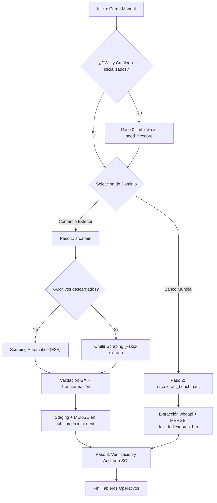

# Guía de Cargas Manuales y Troubleshooting: InsightBolivia

Esta guía técnica describe el procedimiento estándar para ejecutar **cargas manuales, ingestas históricas y reprocesamientos de datos** en la plataforma **InsightBolivia**, así como la resolución sistemática de incidencias y errores frecuentes (*troubleshooting*) en el pipeline ETL, Google BigQuery y Cloud Firestore.

---

## 1. Alcance y Cuándo Usar Cargas Manuales

El pipeline de InsightBolivia opera de forma automatizada mediante flujos programados en GitHub Actions (`.github/workflows/etl_comercio_exterior.yml`). No obstante, la ejecución de **cargas manuales** es necesaria en los siguientes escenarios operativos:

1. **Carga Inicial o Histórica (Backfill):** Ingesta masiva de gestiones pasadas (ej. 2023, 2024, 2025, 2026) durante la puesta en marcha de un nuevo entorno o réplica del Data Warehouse.
2. **Indisponibilidad del Portal del INE:** Fallos de conectividad, caídas del servidor gubernamental (`ine.gob.bo`), errores SSL o bloqueos por WAF que impiden el web scraping automático.
3. **Correcciones Retroactivas de la Fuente:** Publicación de boletines definitivos por parte del INE que sustituyen cifras preliminares (archivos con sufijo `p.xlsx`), requiriendo reprocesamiento forzado.
4. **Actualización de Indicadores Internacionales:** Ingesta o refresco manual de series de tiempo macroeconómicas del Banco Mundial (WDI).
5. **Depuración y Pruebas en Desarrollo/Staging:** Validación local de nuevas reglas de calidad (Great Expectations) o transformaciones sin afectar producción.

---

## 2. Requisitos Previos y Configuración del Entorno

> [!IMPORTANT]
> **Norma Obligatoria de Ejecución:** Toda invocación de herramientas o scripts de Python debe realizarse exclusivamente a través de `uv`. Jamás ejecutes `python` o `pip` directamente en el entorno.

### 2.1 Verificación de Dependencias
Asegúrate de tener el entorno virtual sincronizado y las dependencias actualizadas:

```bash
# Sincronizar dependencias declaradas en pyproject.toml y uv.lock
uv sync

# Verificar que el intérprete de Python esté operativo
uv run python --version
```

### 2.2 Variables de Entorno (`.env`)
El pipeline requiere credenciales de acceso a Google Cloud Platform con permisos sobre BigQuery y Firestore. Verifica que tu archivo `.env` en la raíz del proyecto contenga las siguientes variables:

```bash
# Identificador del Proyecto en Google Cloud
GCP_PROJECT_ID=insight-bolivia

# Ruta a la Service Account Key de GCP
GOOGLE_APPLICATION_CREDENTIALS=credentials/gcp_key.json

# Datasets de BigQuery
BIGQUERY_DATASET_STAGING=staging
BIGQUERY_DATASET_COMERCIO_EXTERIOR=comercio_exterior
BIGQUERY_DATASET_BENCHMARK_REGIONAL=benchmark_regional
BIGQUERY_DATASET_OPERATIONS=operations

# Base de datos Cloud Firestore
FIRESTORE_DATABASE_ID=(default)
```

> [!NOTE]
> La cuenta de servicio debe disponer al menos de los roles IAM: `roles/bigquery.dataEditor`, `roles/bigquery.jobUser` y `roles/datastore.user`.

---

## 3. Procedimiento de Carga Manual Paso a Paso



---

### Paso 0: Aprovisionamiento y Siembra de Dimensiones (Solo Primera Vez)

Si la base de datos está vacía o se está configurando un nuevo proyecto de GCP:

```bash
# 1. Crear datasets, tablas del modelo estrella, vistas SQL y sembrar dimensiones estáticas
uv run python -m src.init_dwh

# 2. Inicializar el catálogo operacional en Cloud Firestore
uv run python -m src.seed_firestore
```

*Qué realiza:* Crea datasets (`staging`, `comercio_exterior`, `benchmark_regional`, `operations`), 12 tablas particionadas y clusterizadas, 3 vistas analíticas pre-agregadas y siembra las dimensiones `dim_tiempo` (2000-2030), `dim_pais`, `dim_via_transporte`, `dim_departamento_origen_destino` y `dim_moneda`.

---

### Paso 1: Carga de Datos de Comercio Exterior (INE Bolivia)

El script orquestador [`src/main.py`](file:///c:/Proyectos/InsightBolivia/insight-bolivia/src/main.py) permite múltiples variantes de ejecución manual según la necesidad:

#### 1.1 Ingesta Completa End-to-End (Web Scraping + Transformación + GX + Carga)
Descarga automáticamente todos los boletines del portal del INE y procesa los archivos nuevos:
```bash
uv run python -m src.main
```

#### 1.2 Ingesta Filtrada por Gestión / Año Específico
Para procesar o actualizar una gestión particular sin escanear archivos ajenos:
```bash
# Cargar exclusivamente el año 2024
uv run python -m src.main --date-range "2024"

# Cargar un rango de meses específico (ej. Enero a Junio 2025)
uv run python -m src.main --date-range "2025-01:2025-06"
```

#### 1.3 Carga desde Archivos Locales (Omitiendo Web Scraping del INE)
Si ya descargaste manualmente los archivos `.xlsx` del portal del INE y los depositaste en `data/raw/comercio exterior/`:
```bash
uv run python -m src.main --skip-extract
```

#### 1.4 Carga de un Archivo Específico Individual
Útil para procesar un archivo puntual que acaba de ser publicado o corregido:
```bash
uv run python -m src.main --skip-extract --file "data/raw/comercio exterior/exportaciones/EXPORTACIONES 2024p.xlsx"
```

#### 1.5 Forzar Reprocesamiento (Ignorar Idempotencia)
Por defecto, el pipeline calcula el hash SHA-256 del archivo y omite aquellos ya registrados en `operations.etl_control_log`. Para forzar la reingesta y actualización de datos:
```bash
uv run python -m src.main --force-reprocess --date-range "2024"
```

#### 1.6 Modo Simulación (*Dry-Run*)
Ejecuta la extracción, lectura, transformación y validación con Great Expectations, pero **no modifica** BigQuery ni Firestore:
```bash
uv run python -m src.main --dry-run --date-range "2024"
```

#### 1.7 Segmentación por Tipo de Operación
Para procesar únicamente exportaciones o únicamente importaciones:
```bash
# Solo exportaciones
uv run python -m src.main -o exportaciones --date-range "2024"

# Solo importaciones
uv run python -m src.main -o importaciones --date-range "2024"
```

---

### Paso 2: Carga de Indicadores Macroeconómicos (Banco Mundial)

Para poblar y actualizar la tabla analítica [`benchmark_regional.fact_indicadores_bm`](file:///c:/Proyectos/InsightBolivia/insight-bolivia/src/extract_benchmark.py) utilizada por el Módulo 05 de Benchmark Regional:

```bash
# Carga estándar (Bolivia, Perú, Chile, Colombia, Paraguay para 2000-2024)
uv run python -m src.extract_benchmark

# Carga personalizada por rango de años y países específicos
uv run python -m src.extract_benchmark --start-year 2015 --end-year 2024 --countries BOL,PER,CHL,COL,PRY

# Forzar recarga omitiendo control de idempotencia
uv run python -m src.extract_benchmark --force
```

---

## 4. Verificación y Auditoría Post-Carga

Tras completar cualquier carga manual, es fundamental verificar la correcta integración de los datos en BigQuery.

### 4.1 Consulta de Validación Rápida en BigQuery
Ejecuta el siguiente comando para verificar los totales anuales en `fact_comercio_exterior`:

```bash
uv run python -c "
import os
from google.cloud import bigquery
from src.config import get_settings

get_settings(load_env=True)
client = bigquery.Client()
q = '''
SELECT 
    EXTRACT(YEAR FROM fecha) AS anio,
    tipo_operacion,
    COUNT(*) AS total_filas,
    ROUND(SUM(valor_fob_usd) / 1e6, 2) AS fob_millones_usd,
    ROUND(SUM(valor_cif_usd) / 1e6, 2) AS cif_millones_usd
FROM \`insight-bolivia.comercio_exterior.fact_comercio_exterior\`
GROUP BY 1, 2
ORDER BY 1, 2
'''
df = client.query(q).to_dataframe()
print(df.to_string(index=False))
"
```

### 4.2 Verificación de Vistas Analíticas
Confirma que la vista pre-agregada de balanza comercial contenga datos:

```bash
uv run python -c "
from google.cloud import bigquery
from src.config import get_settings

get_settings(load_env=True)
client = bigquery.Client()
q = '''
SELECT 
    anio, 
    COUNT(*) AS meses_cargados,
    ROUND(SUM(total_exportaciones_fob_usd) / 1e6, 2) AS exp_musd,
    ROUND(SUM(total_importaciones_cif_usd) / 1e6, 2) AS imp_musd,
    ROUND(SUM(saldo_comercial_usd) / 1e6, 2) AS saldo_musd
FROM \`insight-bolivia.comercio_exterior.vw_balanza_comercial_mensual\`
GROUP BY anio
ORDER BY anio DESC
'''
print(client.query(q).to_dataframe().to_string(index=False))
"
```

### 4.3 Verificación de la Auditoría Operacional
Revisa el registro de auditoría en `operations.etl_control_log`:

```bash
uv run python -c "
from google.cloud import bigquery
from src.config import get_settings

get_settings(load_env=True)
client = bigquery.Client()
q = '''
SELECT 
    execution_id, nombre_archivo, tipo_operacion, registros_procesados, estado, timestamp_inicio
FROM \`insight-bolivia.operations.etl_control_log\`
ORDER BY timestamp_inicio DESC
LIMIT 5
'''
print(client.query(q).to_dataframe().to_string(index=False))
"
```

---

## 5. Matriz de Troubleshooting (Resolución de Problemas)

A continuación se detallan las incidencias técnicas más comunes durante cargas manuales y sus soluciones directas:

### Problema 1: Los Tableros en Streamlit Aparecen Vacíos
- **Síntoma:** BigQuery contiene cientos de miles de registros, pero en la interfaz web de Streamlit todos los filtros, tablas y gráficos muestran "No hay datos disponibles" o errores silenciosos.
- **Causa Raíz:** Falta el paquete [`db-dtypes`](file:///c:/Proyectos/InsightBolivia/insight-bolivia/pyproject.toml) en el entorno de Python. El método `query_job.to_dataframe()` de Google Cloud BigQuery requiere `db-dtypes` para mapear columnas `DATE`, `TIME` o `NUMERIC` a Pandas; al no estar presente, la llamada falla de forma silenciosa y retorna un DataFrame vacío (`pd.DataFrame()`).
- **Solución:**
  ```bash
  uv add db-dtypes
  uv sync
  ```

---

### Problema 2: Error `ArrowInvalid: Got bytestring of length 8 (expected 16)` o `Rescaling Decimal value would cause data loss`
- **Síntoma:** La carga hacia BigQuery falla durante `load_table_from_dataframe` al procesar tablas staging.
- **Causa Raíz:** Las columnas de tipo `NUMERIC` en BigQuery corresponden a enteros de 128 bits con escala fija (hasta 9 decimales). Si el DataFrame contiene valores de tipo `float64` (8 bytes) o números `decimal.Decimal` con más de 9 dígitos decimales, el conversor PyArrow rechaza los datos.
- **Solución:** Asegurar que los campos monetarios (`valor_fob_usd`, `valor_cif_usd`) y físicos (`peso_bruto_kg`, `peso_neto_kg`) utilicen la función helper `_safe_to_decimal()` con cuantización a 9 decimales:
  ```python
  from decimal import Decimal
  val = Decimal(str(round(float(x), 9))).quantize(Decimal("1e-9"))
  ```

---

### Problema 3: Las Particiones Históricas Desaparecen Inmediatamente de Staging
- **Síntoma:** Al cargar archivos históricos (ej. 2023 o 2024), BigQuery confirma la inserción de filas, pero al consultar la tabla `stg_comercio_exterior` no hay ningún registro.
- **Causa Raíz:** El dataset `staging` tenía configurado un tiempo de expiración de partición por defecto (`default_partition_expiration_ms = 180 días`), y la tabla estaba particionada por la columna `fecha` de la operación aduanera. Al ser fechas mayores a 180 días en el pasado, BigQuery purgaba las particiones instantáneamente al crearlas.
- **Solución:** Eliminar la expiración de particiones en el dataset `staging`:
  ```sql
  ALTER SCHEMA `insight-bolivia.staging`
  SET OPTIONS(default_partition_expiration_days = NULL);
  ```

---

### Problema 4: Error `400 UPDATE/MERGE must match at most one source row for each target row`
- **Síntoma:** La sentencia `MERGE` en `comercio_exterior.fact_comercio_exterior` falla con código HTTP 400.
- **Causa Raíz:** En las fuentes oficiales del INE existen múltiples transacciones aduaneras que comparten exactamente la misma clave natural compuesta dentro del mismo mes (`fecha`, `codigo_nandina`, `pais_iso`, `tipo_operacion`, `id_departamento`, `id_via_transporte`, `id_aduana`).
- **Solución:** La sentencia SQL del `MERGE` debe realizar un `GROUP BY` sobre la clave compuesta en la cláusula `USING`, sumando las métricas aditivas (`SUM(valor_fob_usd)`, `SUM(peso_bruto_kg)`, etc.) antes de empatar contra la tabla destino.

---

### Problema 5: Error en SCD Tipo 2 de `dim_producto` por Violación de Clave
- **Síntoma:** Al insertar o actualizar productos arancelarios en `dim_producto`, se generan registros duplicados o colisiones en la dimensión de tipo 2.
- **Causa Raíz:** Un mismo código arancelario de 10 dígitos (NANDINA) puede aparecer en el archivo del INE con variaciones léxicas mínimas o mayúsculas/minúsculas en su descripción para un mismo lote.
- **Solución:** Aplicar deduplicación analítica con función ventana antes de la sincronización:
  ```sql
  QUALIFY ROW_NUMBER() OVER (
      PARTITION BY codigo_nandina 
      ORDER BY fecha DESC, descripcion_nandina DESC
  ) = 1
  ```

---

### Problema 6: Fallo en Validación Great Expectations: `ExpectColumnPairValuesAToBeGreaterThanB`
- **Síntoma:** La suite de Great Expectations rechaza los archivos de importaciones con error de calidad de datos en la regla `peso_bruto_kg >= peso_neto_kg`.
- **Causa Raíz:** En las estadísticas de **Importaciones** publicadas por el INE, la columna de `peso_neto_kg` no existe o viene vacía (100% nula), ya que la aduana boliviana liquida importaciones sobre peso bruto.
- **Solución:** Configurar en `gx/expectations/comercio_exterior_suite.json` y en `src/validate.py` el parámetro:
  ```json
  "ignore_row_if": "either_value_is_missing"
  ```
  Esto permite que la comparación física aplique estrictamente cuando ambos valores estén presentes (exportaciones) y se omita de forma segura en importaciones.

---

### Problema 7: Timeout o Error SSL al Descargar desde el Portal del INE (`ine.gob.bo`)
- **Síntoma:** La extracción web falla con `requests.exceptions.SSLError`, `ConnectionTimeout` o `HTTP 403 Forbidden`.
- **Causa Raíz:** Los servidores del INE implementan reglas WAF estrictas, certificados intermedios no reconocidos o sufren cortes periódicos de servicio.
- **Solución (Bypass Manual):**
  1. Abre el navegador web y accede directamente a la sección de estadísticas de Comercio Exterior del INE.
  2. Descarga los archivos Excel (`.xlsx` o `.zip`).
  3. Colócalos en el directorio local correspondiente:
     - Exportaciones: `data/raw/comercio exterior/exportaciones/`
     - Importaciones: `data/raw/comercio exterior/importaciones/`
  4. Ejecuta el pipeline omitiendo la descarga web:
     ```bash
     uv run python -m src.main --skip-extract
     ```

---

### Problema 8: El Pipeline Omite un Archivo que Necesita ser Actualizado
- **Síntoma:** Ejecutas el pipeline pero el archivo aparece como `SKIPPED (already processed)`.
- **Causa Raíz:** El hash SHA-256 del archivo ya figura en la tabla `operations.etl_control_log` con estado `SUCCESS`.
- **Solución:** Agrega el flag `--force-reprocess` (o `-f`) para forzar la revalidación y la ejecución del `MERGE`:
  ```bash
  uv run python -m src.main --force-reprocess --file "data/raw/comercio exterior/exportaciones/EXPORTACIONES 2024p.xlsx"
  ```

---

## 6. Buenas Prácticas Operativas y de Seguridad

1. **Control de Costos en Capa Gratuita ($0 USD):**
   - Siempre incluye filtros por la columna `fecha` en tus consultas exploratorias en BigQuery para aprovechar el particionamiento mensual y no agotar la cuota gratuita de 1 TB/mes.
   - Jamás ejecutes `SELECT * FROM fact_comercio_exterior` sin cláusula `WHERE fecha BETWEEN ...` y `LIMIT`.
2. **Cero Credenciales en Código:**
   - No guardes claves de Service Accounts (`.json`) dentro del árbol de git. Usa exclusivamente `.env` y verifica que esté incluido en `.gitignore`.
3. **Validación de Límites en Streamlit:**
   - La aplicación web en Streamlit Cloud cuenta con 1 GB de RAM. Para evitar errores de memoria (OOM), el Centro de Descargas restringe las exportaciones a un máximo estricto de **50,000 registros**.
4. **Verificación de Calidad Post-Modificación:**
   - Antes de subir cualquier cambio a producción, valida que las pruebas unitarias pasen con cobertura $\ge 90\%$ y sin alertas de estilo:
     ```bash
     uv run ruff check .
     uv run pytest --cov=src --cov-fail-under=90
     ```
