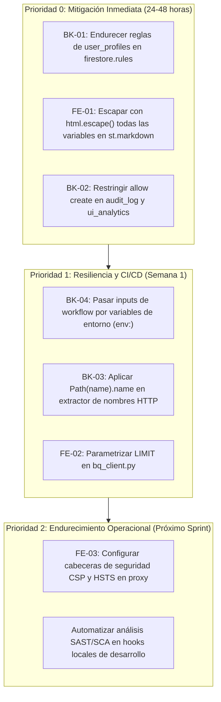

# Resumen Ejecutivo de Seguridad Integral (FullStack V1)
**Plataforma:** InsightBolivia  
**Alcance:** Backend ETL, Data Warehouse (BigQuery), Base de Datos NoSQL (Cloud Firestore), Frontend Streamlit y CI/CD  
**Fecha de Publicación:** Octubre 2026  
**Clasificación:** Confidencial / Auditoría Técnica  

---

## 1. Estado de Salud General de la Plataforma

InsightBolivia presenta una **postura de seguridad y calidad técnica notablemente sólida en sus bases arquitectónicas**, evidenciada por:
- **0 vulnerabilidades conocidas (CVEs)** en todas las dependencias del ecosistema de producción y desarrollo (`pip-audit`).
- **0 advertencias de linter y análisis estático** bajo las estrictas reglas de Ruff y Bandit (`ruff check .`).
- **98.58% de cobertura de pruebas unitarias** con **748 pruebas automatizadas** superadas con éxito.
- **Cero credenciales hardcodeadas** en el código fuente y exclusión estricta de archivos de secretos en el control de versiones.
- **Consultas BigQuery altamente optimizadas y seguras**, particionadas mensualmente y parametrizadas para operar con costo \$0 USD dentro de la capa Always Free Tier.

Sin embargo, la auditoría ha identificado **vulnerabilidades puntuales de configuración lógica y sanitización** que, al combinarse, representan un riesgo crítico para la integridad de la plataforma.

---

## 2. Top 3 Vulnerabilidades Más Críticas

```
+----------------------------------------------------------------------------------------------------+
| 1. Escalamiento de Privilegios a Administrador en Cloud Firestore (CWE-269 / CVSS: 8.8 - CRÍTICO) |
| 2. Vulnerabilidad de Cross-Site Scripting (XSS) en Streamlit (CWE-79 / CVSS: 7.4 - ALTO)          |
| 3. Inundación No Autenticada y Agotamiento de Cuotas en Firestore (CWE-770 / CVSS: 7.3 - ALTO)     |
+----------------------------------------------------------------------------------------------------+
```

### 1. Escalamiento de Privilegios en Cloud Firestore (CWE-269 — Crítica)
- **Problema:** En `firestore/rules/firestore.rules`, la regla de escritura para `user_profiles/{userId}` permite que cualquier usuario autenticado modifique su propio documento. Dado que el rol del usuario se almacena en ese mismo documento (`role: "admin"`), un atacante con rol básico puede elevarse a sí mismo a administrador total de la plataforma.
- **Severidad:** 🔴 **Crítica (8.8)**.

### 2. Cross-Site Scripting (XSS) en Componentes Streamlit (CWE-79 — Alto)
- **Problema:** En `streamlit_app/app.py` y las páginas `02_socios_comerciales.py`, `03_productos_top.py` y `05_benchmark_regional.py`, se interpolan valores dinámicos provenientes de bases de datos externas dentro de bloques `st.markdown(..., unsafe_allow_html=True)` sin escapar caracteres HTML con `html.escape()`.
- **Severidad:** 🔴 **Alto (7.4)**.

### 3. Ingestión Pública No Autenticada en Auditoría y Telemetría (CWE-770 — Alto)
- **Problema:** Las colecciones `audit_log` y `ui_analytics` tienen configurado `allow create: if true;`, permitiendo que bots o actores externos generen millones de inserciones maliciosas o con cargas pesadas, agotando las cuotas del Always Free Tier (20k escrituras/día) y generando denegación de servicio o sobrecostos.
- **Severidad:** 🟠 **Alto (7.3)**.

---

## 3. Riesgos de Superficie Combinada (Ataques Encadenados)

```
[Atacante con cuenta básica]
             │
             ▼  1. Autoasignación role="admin" en /user_profiles/{userId} (BK-01)
[Escalamiento de Privilegios en Firestore]
             │
             ▼  2. Inyección de payload XSS en campo data_source de /dwh_catalog (BK-01)
[Persistencia de Carga Maliciosa en Base de Datos]
             │
             ▼  3. Carga se renderiza sin sanitizar vía unsafe_allow_html=True (FE-01)
[Ejecución de Stored XSS en Navegador del Administrador Real]
             │
             ▼  4. Robo de credenciales de sesión y falsificación de telemetría
[Compromiso Total de la Interfaz y Confianza Operativa]
```

### Análisis del Vector Encadenado Principal:
Un atacante que descubra la debilidad en las reglas de Firestore (BK-01) puede auto-otorgarse el rol de administrador. Con estos privilegios, puede alterar el registro del catálogo DWH (`/dwh_catalog/comercio_exterior`) insertando una carga XSS en el campo de texto `data_source` o `description`. Debido a la debilidad detectada en el frontend (FE-01), cuando un operador o usuario legítimo visita la página principal del dashboard, la carga se ejecuta automáticamente en su navegador, logrando la ejecución de código en el cliente (Stored XSS).

---

## 4. Matriz Global de Hallazgos y Severidad

| Código | Vector | Hallazgo Técnico | Severidad | CVSS | Estado |
| :---: | :---: | :--- | :---: | :---: | :---: |
| **BK-01** | Backend / NoSQL | Escalamiento de Privilegios en `user_profiles` Firestore | 🔴 Crítica | 8.8 | Confirmado |
| **FE-01** | Frontend / UI | Stored & Reflected XSS en `st.markdown(unsafe_allow_html=True)` | 🔴 Alta | 7.4 | Confirmado |
| **BK-02** | Backend / NoSQL | Escritura Pública Irrestricta en `audit_log` y `ui_analytics` | 🟠 Alta | 7.3 | Confirmado |
| **BK-04** | CI/CD | Inyección de Comandos en Workflow GitHub Actions | 🟡 Media | 6.1 | Confirmado |
| **BK-03** | Backend / ETL | Posible Path Traversal vía Header `Content-Disposition` | 🟡 Media | 5.9 | Confirmado |
| **FE-02** | Frontend / DB | Cláusula `LIMIT` sin parametrizar en consulta analítica | 🟡 Media | 5.3 | Confirmado |
| **FE-03** | Frontend / Servidor | CORS Permisivo y ausencia de directivas CSP en Streamlit | 🟢 Baja | 3.7 | Confirmado |

---

## 5. Mapa de Prioridades para el Equipo de Desarrollo



### Acciones Específicas Recomendadas:

1. **Sprint Inmediato (P0):**
   - Actualizar `firestore/rules/firestore.rules` prohibiendo la modificación del campo `role` por usuarios no administradores y eliminando la creación pública anónima en logs.
   - Refactorizar las llamadas a `st.markdown(..., unsafe_allow_html=True)` en `streamlit_app/app.py` y `streamlit_app/pages/*.py` aplicando `html.escape()`.
2. **Sprint de Integración (P1):**
   - Modificar `.github/workflows/etl_comercio_exterior.yml` para mapear inputs a `env:`.
   - Modificar `src/extract_comercio_exterior.py` asegurando `Path(decoded).name`.
   - Parametrizar `@limit_val` en `streamlit_app/utils/bq_client.py`.

---

## 6. Conclusión y Veredicto del Auditor

La plataforma **InsightBolivia** cuenta con una base de ingeniería de datos excepcionalmente madura, con 0 vulnerabilidades en dependencias, excelente diseño de Data Warehouse en BigQuery y una cobertura de pruebas superior al 98%.

La resolución de las observaciones identificadas en este informe (especialmente el endurecimiento de las reglas de Firestore y el escape de salidas HTML) colocará a InsightBolivia en un **nivel óptimo de seguridad defensiva de grado de producción**, protegiendo tanto los datos públicos de comercio exterior como la infraestructura en la nube de Bolivia.
