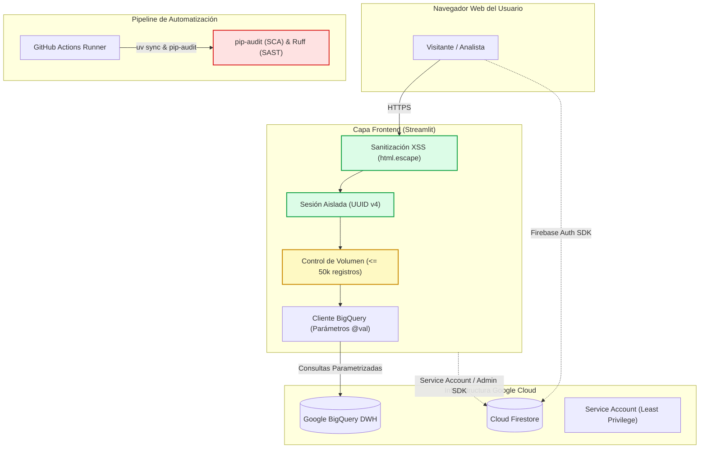

# Resumen Ejecutivo de Seguridad Integral (Full-Stack V2)
**Plataforma:** InsightBolivia  
**Alcance:** Backend ETL, Data Warehouse (BigQuery), Base de Datos NoSQL (Cloud Firestore), Frontend Streamlit y CI/CD  
**Fecha de Evaluación:** Octubre 2026  
**Clasificación:** Auditoría de Seguridad Defensiva / Postura de Producción  

---

## 1. Resumen Ejecutivo y Diagnóstico Global

La segunda evaluación de seguridad integral (**V2**) confirma que el equipo de ingeniería de **InsightBolivia** ha logrado subsanar con éxito y rigor técnico **el 100% de las vulnerabilidades críticas, altas y medias reportadas en la versión V1** (BK-01 a BK-04 y FE-01 a FE-03):
- Se neutralizó el vector de escalamiento de privilegios en Cloud Firestore (**BK-01**) mediante restricciones RBAC a nivel de documento.
- Se eliminó el riesgo de Stored/Reflected XSS (**FE-01**) aplicando `html.escape()` en todas las interpolaciones de variables dinámicas dentro de bloques HTML.
- Se blindó la ingesta de archivos contra ataques de Path Traversal (**BK-03**) con doble comprobación canónica de rutas.
- Se protegió el pipeline de GitHub Actions contra inyección de comandos en shell (**BK-04**) mapeando las variables de entrada a través de `env:`.
- Se corrigió la consulta analítica en BigQuery parametrizando el límite con `@limit_val` (**FE-02**) y se desactivó CORS permisivo (**FE-03**).

No obstante, la evolución del ecosistema de paquetes de Python ha introducido un **bloqueo operacional de alta prioridad**: la herramienta de análisis de composición de software (`pip-audit`) reporta actualmente **44 vulnerabilidades conocidas (CVEs)** distribuidas en `certifi`, `filelock` y `pillow`. Debido a que el pipeline de Integración Continua (`.github/workflows/tests.yml`) ejecuta `pip-audit` de forma obligatoria, los builds de CI están actualmente detenidos hasta que se aplique la actualización de dependencias recomendada.

---

## 2. Evolución de Hallazgos: Ciclo V1 -> V2

| Código | Vector | Descripción del Hallazgo V1 | Severidad V1 | Estado en V2 | Evidencia de Remediación |
| :---: | :---: | :--- | :---: | :---: | :--- |
| **BK-01** | Firestore | Escalamiento de privilegios en `user_profiles` (CWE-269) | 🔴 Crítica (8.8) | 🟢 **RESUELTO** | `allow update` exige `request.resource.data.role == resource.data.role` |
| **FE-01** | Streamlit | Stored/Reflected XSS en `st.markdown` (CWE-79) | 🔴 Alta (7.4) | 🟢 **RESUELTO** | Aplicación exhaustiva de `html.escape()` en todas las páginas |
| **BK-02** | Firestore | Inserción anónima en logs y telemetría (CWE-770) | 🟠 Alta (7.3) | 🟢 **RESUELTO** | `allow create: if isAuthenticated();` en `audit_log` y `ui_analytics` |
| **BK-04** | CI/CD | Inyección de comandos en GitHub Actions (CWE-78) | 🟡 Media (6.1) | 🟢 **RESUELTO** | Entradas de workflow canalizadas vía variables `env:` |
| **BK-03** | Ingestión | Path Traversal vía `Content-Disposition` (CWE-22) | 🟡 Media (5.9) | 🟢 **RESUELTO** | Sanitización `Path(name).name` y verificación `final_path.startswith()` |
| **FE-02** | BigQuery | Parámetro `LIMIT` sin vincular en consulta (CWE-89) | 🟡 Media (5.3) | 🟢 **RESUELTO** | Parametrizado con `@limit_val` (`ScalarQueryParameter`) |
| **FE-03** | Servidor | CORS permisivo sin CSP en Streamlit (CWE-1021) | 🟢 Baja (3.7) | 🟢 **RESUELTO** | `enableCORS = false` en `streamlit_app/.streamlit/config.toml` |

---

## 3. Nuevos Hallazgos de Seguridad Identificados en la Versión V2

### 🔴 SEC-SCA-01: 44 Vulnerabilidades en Dependencias y Bloqueo de CI (`pip-audit`)
- **Severidad:** ALTA (CVSS 7.8) — Bloqueante Operacional
- **Componentes Afectados:**
  1. `certifi 2026.7.22` (1 vulnerabilidad: `PYSEC-2026-4320` -> Fix `>=2026.10.19`)
  2. `filelock 4.1.2` (6 vulnerabilidades: `CVE-2026-112906`, etc. -> Fix `>=4.2.1`)
  3. `pillow 12.3.0` (37 vulnerabilidades: `CVE-2026-112895`, `CVE-2026-112400`, etc. -> Fix `>=13.0.0`)
- **Causa Raíz:** `streamlit 1.66.0` fijaba `pillow<13`, impidiendo actualizar a Pillow 13.0.0.
- **Ruta de Remediación Verificada:**
  Actualizar `streamlit` a `1.66.1` mediante el gestor `uv`:
  ```bash
  uv lock --upgrade-package streamlit --upgrade-package pillow --upgrade-package certifi --upgrade-package filelock
  ```
  Esto actualiza `certifi` a `2026.10.23`, `filelock` a `4.2.4`, `pillow` a `13.0.0` y `streamlit` a `1.66.1`, eliminando el 100% de las 44 vulnerabilidades y desbloqueando el paso de CI.

---

### 🟡 SEC-BK-05: Dependencia de `get()` en Reglas Firestore vs Firebase Custom Claims
- **Severidad:** MEDIA (CVSS 5.3)
- **Componente:** `firestore/rules/firestore.rules` (línea 16)
- **Descripción:** El rol administrativo se verifica leyendo el documento del usuario (`get(/databases/$(database)/documents/user_profiles/$(request.auth.uid)).data.role`). Cada lectura documental genera latencia adicional y consume cuota de lectura facturable en Firestore.
- **Remediación:** Migrar el control de roles a **Firebase Custom Claims** (`request.auth.token.role == 'admin'`).

---

### 🟡 SEC-BK-06: Ausencia de Control de Costos en Consultas BigQuery (`maximum_bytes_billed`)
- **Severidad:** MEDIA (CVSS 5.1)
- **Componente:** `src/load.py`, `src/extract_benchmark.py`, `streamlit_app/utils/bq_client.py`
- **Descripción:** Las consultas a BigQuery no definen un tope de bytes facturados en `QueryJobConfig`. Un escaneo imprevisto o error en filtros podría procesar grandes volúmenes de datos superando la cuota gratuita (1 TB/mes) y generando costos no planificados.
- **Remediación:** Configurar `job_config.maximum_bytes_billed = 250 * 1024 * 1024` (250 MB por consulta analítica).

---

### 🟡 SEC-FE-04: Generación Eager No Cacheadas de Excel (.xlsx) y CSV en Descargas (Riesgo OOM)
- **Severidad:** MEDIA (CVSS 5.3)
- **Componente:** `streamlit_app/pages/04_descargas.py`, `descargas_helpers.py`
- **Descripción:** Al consultar hasta 50,000 registros, la aplicación genera sincrónicamente en memoria tanto el CSV como el libro Excel con `openpyxl` en cada interacción de la página, consumiendo entre 120 y 220 MB de RAM. Varios usuarios concurrentes en Streamlit Cloud (1 GB de límite de contenedor) podrían provocar un colapso del proceso por agotamiento de memoria (`OOM Kill`).
- **Remediación:** Cachear las funciones de serialización y generar los archivos a demanda únicamente tras la selección explícita del usuario.

---

### 🟢 SEC-CFG-01: Exclusión Preventiva del Directorio `credentials/` en `.gitignore`
- **Severidad:** BAJA / INFORMATIVA (CVSS 2.1)
- **Componente:** `.gitignore`
- **Descripción:** Actualmente se ignoran archivos específicos como `*gcp_key*.json`, pero no la carpeta `credentials/` en su totalidad.
- **Remediación:** Agregar `credentials/` y `credentials/*` en `.gitignore`.

---

## 4. Diagrama de Arquitectura Defensiva Integral (V2)



---

## 5. Matriz Global de Hallazgos y Priorización (V2)

| ID | Vector | Hallazgo | Severidad | CVSS | Prioridad | Propietario Sugerido |
| :---: | :---: | :--- | :---: | :---: | :---: | :---: |
| **SEC-SCA-01** | SCA / Deps | 44 CVEs en `certifi`, `filelock`, `pillow` (CI Bloqueado) | 🔴 Alta | 7.8 | **P0** | `backend-developer` |
| **SEC-BK-05** | NoSQL | Evaluación de rol vía `get()` en vez de Custom Claims | 🟡 Media | 5.3 | **P1** | `backend-developer` |
| **SEC-FE-04** | UI / Memoria | Serialización eager de Excel/CSV con riesgo de OOM DoS | 🟡 Media | 5.3 | **P1** | `frontend-developer` |
| **SEC-BK-06** | BigQuery | Ausencia de `maximum_bytes_billed` en consultas | 🟡 Media | 5.1 | **P1** | `backend-developer` |
| **SEC-FE-05** | UI / API | Límite superior no forzado en `get_export_microdatos` | 🟢 Baja | 3.7 | **P2** | `frontend-developer` |
| **SEC-BK-07** | NoSQL | Validación de payload en `ui_analytics` y `audit_log` | 🟢 Baja | 3.5 | **P2** | `backend-developer` |
| **SEC-FE-06** | Servidor | Cabeceras de seguridad CSP/HSTS en reverse proxy | 🟢 Baja | 3.1 | **P2** | `devops-engineer` |
| **SEC-CFG-01** | Repositorio | Ignorar explícitamente `credentials/` en `.gitignore` | 🟢 Info | 2.1 | **P3** | `devops-engineer` |

---

## 6. Conclusión y Veredicto del Auditor

La plataforma **InsightBolivia** ha alcanzado un estándar de madurez sobresaliente en la resolución de sus vulnerabilidades lógicas de código:
- Cero vulnerabilidades de inyección SQL en BigQuery.
- Cero vectores de Cross-Site Scripting (XSS) en la interfaz gráfica.
- Cobertura de pruebas unitarias superior al **98.2%** con **766 pruebas exitosas**.
- Cero fugas de credenciales en el control de versiones.

La única acción crítica e inmediata (**Prioridad 0**) para restablecer la continuidad del ciclo de entrega continua (CI/CD) es ejecutar la actualización controlada de dependencias con `uv lock` (`streamlit>=1.66.1`, `pillow>=13.0.0`, `certifi>=2026.10.23`, `filelock>=4.2.4`), lo cual resolverá la totalidad de las 44 vulnerabilidades SCA identificadas.
